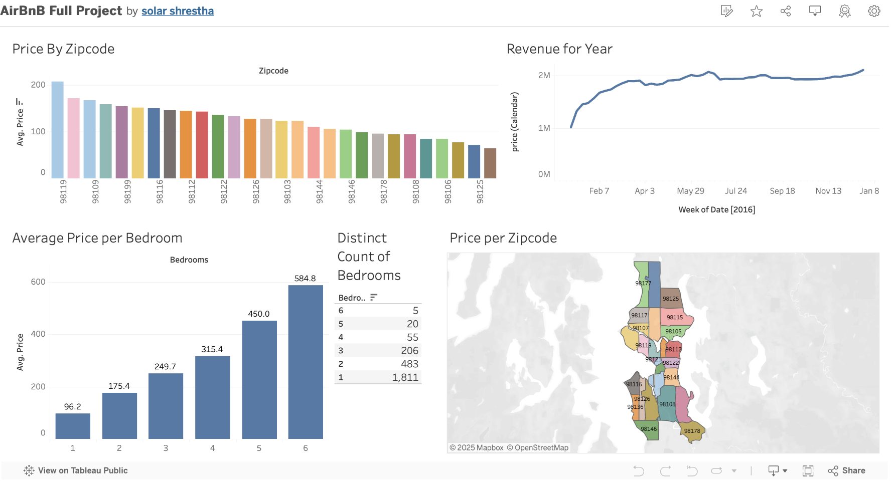

# Seattle Airbnb Market Dashboard (Tableau)

How do size and location drive Airbnb prices in Seattle? An interactive Tableau Public dashboard built on 2016 Seattle listing and calendar data.

**Interactive dashboard:** [Tableau Public](https://public.tableau.com/app/profile/solar.shrestha/viz/AirBnBFullProject_17397558343190/Dashboard1)

## Key findings
| Question | Finding |
|---|---|
| Size | Average nightly price rises with every bedroom: $96 (1) → $175 (2) → $250 (3) → $315 (4) → $450 (5) → $585 (6) |
| Value per bedroom | Price per bedroom dips from $96 (1 bedroom) to $79 (4 bedrooms), then climbs to $98 (6 bedrooms) |
| Supply | 1-bedroom listings are 70% of supply (1,811 of 2,580); only 80 listings (3%) have 4+ bedrooms |
| Location | ZIP 98119 (Queen Anne) averages about $200 a night, roughly 3× the lowest-priced ZIP codes |
| Season | Weekly calendar price total climbs from ~$1.0M in early January to ~$1.9M by late spring, then holds |

## Dashboard views
Price by Zipcode (sorted bars) · Revenue for Year (weekly line) · Average Price per Bedroom (bars) · Distinct Count of Bedrooms (table) · Price per Zipcode (filled map)

## Limitations
The revenue line sums listed calendar prices (potential, not confirmed, revenue); averages can be skewed by luxury listings; Seattle 2016 only.
