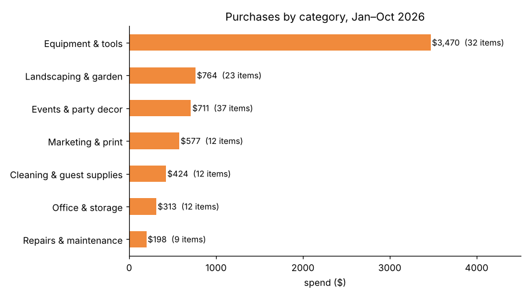
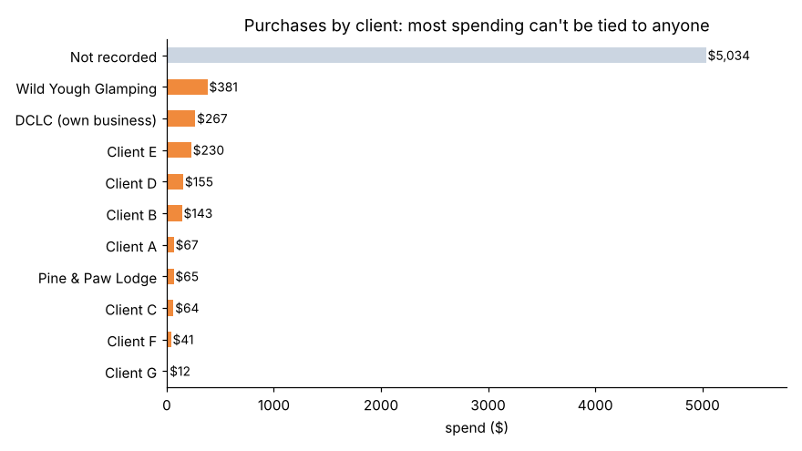

# DCLC Expense & Job-Costing Analysis — 2026

Where does a small property-services business spend its money, and can its expense log show what each client costs to serve? Data from **Deep Creek Lake Concierge** (Deep Creek Lake, MD).

**Data:** the [DCLC Vehicle & Expense Log](../vehicle-expense-log) (phone form → Google Sheet), Jan 23 – Oct 31, 2026: 137 purchases ($6,458), 16 business meals, 14 trips and 1 fuel fill-up. Private client names are replaced with *Client A, B, C…*; receipt links and addresses are removed.
**Tools:** Python (pandas, matplotlib), SQL, Jupyter

## Key findings

| Question | Finding | Recommendation |
|---|---|---|
| Where the money goes | Equipment & tools is 54% of purchases ($3,470); 10 one-off buys of $100+ make up 39% of the year | Track big equipment separately from day-to-day supplies |
| Seasonality | June–August is 60% of the year's purchases | Budget for a summer spike; buy landscaping and event supplies before June |
| Events | Party and wedding decor: 37 items, $711, 76% with no client | Treat event decorating as its own priced service line |
| Job costing | 78% of purchase dollars ($5,034) have no client, so cost per client can't be calculated | Make *client* a required dropdown in the log form |
| Trips | October: 14 trips, 227 miles, $173 mileage value; Pine & Paw Lodge is 37% of miles; no trips logged before October | Log every trip when it happens |
| Data quality | 93% of purchases categorized "Supplies"; vendors spelled several ways; 23% missing receipts; 1 fuel entry; all entered Oct 17–28 | Dropdowns for category and vendor; required receipt photo; log fuel with odometer |

## Method
1. **Check quality** – profiled each field before analysis (category, vendor, client, receipt, entry dates).
2. **Clean** – standardized vendor and client names, rebuilt a spending category from each item description with keyword rules, flagged $100+ equipment, reviewed repeated lines.
3. **Analyze** – spend by category, month and client in pandas; mileage value using the rate in effect on each trip date; then answered the same questions in SQL ([expense_analysis.sql](expense_analysis.sql)) with window functions (`SUM() OVER`, `RANK`, running totals, `LAG`).

## Files
| File | Contents |
|---|---|
| `expense_analysis.ipynb` | Full analysis with outputs and charts |
| `expense_analysis.sql` | SQL version of the analysis (MySQL 8) |
| `purchases_raw.csv`, `meals_raw.csv`, `trips_raw.csv`, `fuel_raw.csv`, `mileage_rates.csv` | Anonymized exports of each sheet in the log |
| `purchases_clean.csv` | Cleaned purchases with rebuilt categories |

## Limitations
About 10 months of data from one small business; purchases were back-filled from order history; trips cover October only; categories come from keyword rules and may misplace a few items.
