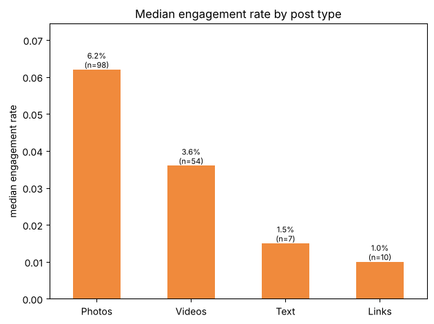
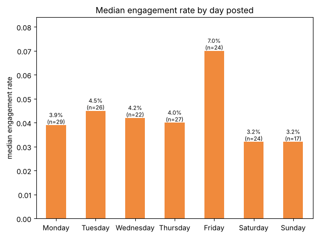

# Facebook Engagement Analysis — 2026

Which Facebook posts drive views and interaction for two Deep Creek Lake, MD hospitality pages (**Deep Creek Lake Concierge** and **Pine & Paw Lodge**)?

**Data:** Meta Business Suite content export, Jan 1 – Nov 1, 2026: 225 posts, of which 169 are original page posts used in the analysis (group cross-posts and shares of other pages' posts excluded).
**Tools:** Python (pandas, matplotlib), SQL, Jupyter

## Key findings

| Question | Finding | Recommendation |
|---|---|---|
| Post type | Photos get the highest engagement (6.2% median vs 3.6% for videos), but videos reach more people (233 vs 150 median views) | Use photos for interaction, videos for reach |
| Day | Friday posts get 7.0% engagement vs 3.2–4.5% on other days | Schedule key promotions for Friday |
| Time | Morning posts (6–11am ET) get 4.7% vs ~3.3% afternoon/evening | Keep posting around 9am |
| Season | May–August strongest (May 6.9%); Feb–Mar ~1% | Plan winter content and early-booking offers ahead of slow months |
| Reshares | Shared posts from other pages: 45 median views vs 161 for original posts, almost no interaction | Post original content instead of reshares |

## Method
1. **Clean** – renamed columns, converted publish times from Pacific to Eastern, added day, hour, time of day, month, season, caption length and call-to-action flags.
2. **Metric** – engagement rate = (reactions + comments + shares) ÷ views; click rate = clicks ÷ views. Medians are used because views are highly skewed.
3. **Analyze** – compared post type, day, time and month in pandas, then answered the same questions in SQL ([facebook_analysis.sql](facebook_analysis.sql)), including window functions (`RANK`, running totals, `LAG`).

## Files
| File | Contents |
|---|---|
| `facebook_engagement_analysis.ipynb` | Full analysis with outputs and charts |
| `facebook_analysis.sql` | SQL version of the analysis (MySQL 8) |
| `facebook_posts_2026.csv` | Raw Meta export |
| `facebook_posts_clean.csv` | Cleaned data with derived features |

## Limitations
About 10 months of data from two small pages; Meta's export has views but no separate reach metric; small groups (fewer than 5 posts) are not compared.
