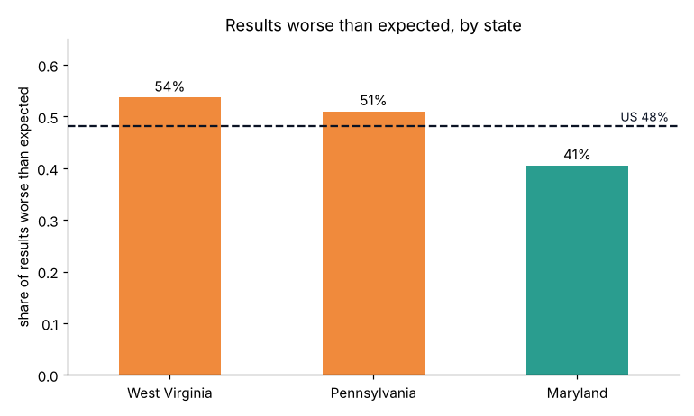
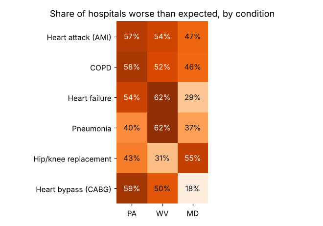

# Hospital Readmissions: PA, WV & MD

Which hospitals in Pennsylvania, West Virginia and Maryland have more 30-day Medicare readmissions than expected, and for which conditions?

**Data:** CMS Hospital Readmissions Reduction Program FY 2026 (discharges Jul 2021 – Jun 2024) joined to CMS Hospital General Information. 201 hospitals, 835 reported hospital-condition results.
**Interactive dashboard:** [Tableau Public](https://public.tableau.com/app/profile/solar.shrestha/viz/HospitalReadmissionsPAWVMD/ReadmissionsDashboard)
**Tools:** Tableau, Python (pandas, matplotlib), SQL, Jupyter

## Key findings

| Question | Finding | Recommendation |
|---|---|---|
| States vs nation | WV (54%) and PA (51%) have more results worse than expected than the US (48%); MD is 41% | Focus readmission programs on PA and WV |
| Conditions | WV: 62% of hospitals worse than expected for heart failure and pneumonia; PA: bypass 59%, COPD 58%, heart attack 57% | Target discharge planning by condition and state |
| Hospitals | Of 172 hospitals with 3+ results, 10 are worse than expected on every condition, 12 on none | Learn from consistent performers |
| Star ratings | Average ratio falls from 1.028 (1-star) to 0.983 (5-star); correlation −0.29 | Include readmission follow-up in quality programs |
| Local | Garrett Regional Medical Center (Oakland, MD) ranks 2nd of 172 | Small rural hospitals can match academic centers |

## Files
| File | Contents |
|---|---|
| `hospital_readmissions_analysis.ipynb` | Full analysis with outputs and charts |
| `readmissions_analysis.sql` | SQL version (MySQL 8): CTEs, joins, RANK, NTILE |
| `readmissions_pa_wv_md.csv` | Cleaned, combined data used for Tableau |
| `national_benchmarks.csv` | US median ratio and rate per condition |

## Limitations
Medicare patients only; CMS exempts Maryland hospitals from HRRP payment penalties under the state's own model; small hospitals often have too few cases to report; the hospital average weights conditions equally.
