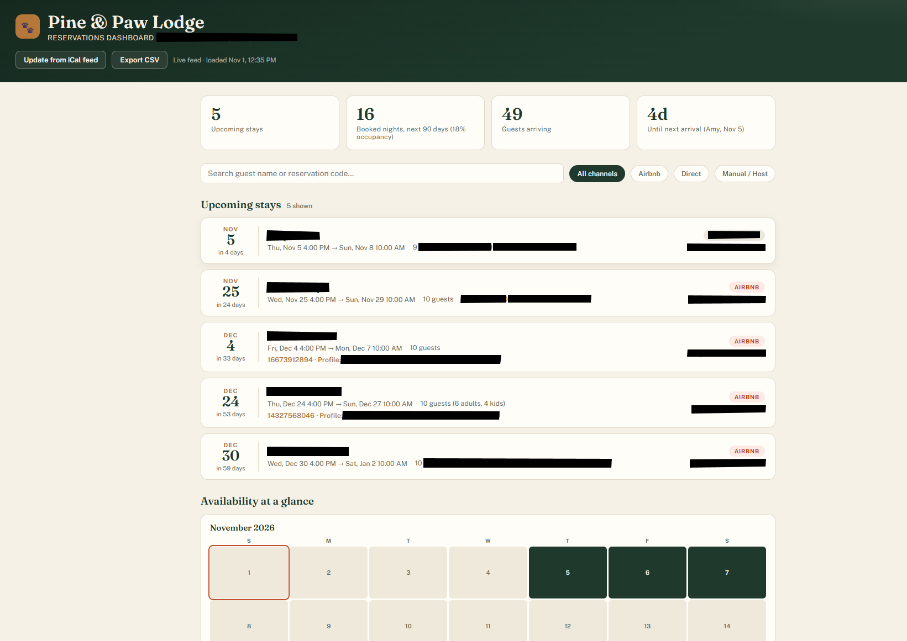

# Reservation Management Dashboard

A browser-based dashboard that consolidates vacation-rental bookings from multiple channels into a single view, built for **Pine & Paw Lodge** (luxury cabin, Deep Creek Lake, MD) and adapted for **Wild Yough Glamping** (5-hut glampground, Oakland, MD).

## The problem
Bookings came in through several platforms (Airbnb, Booking.com, Hipcamp, direct), each with its own calendar. Owners had no single place to see occupancy, upcoming arrivals, or revenue, and tracking happened in a manually updated spreadsheet.

## What I built
- **Live iCal integration** — pulls each channel's calendar feed and merges them into one reservation timeline
- **Occupancy view** — booked vs. open nights per unit
- **Editable reservation records** — add, edit and delete reservations and nightly rates in-page, synced for all viewers through a live database
- **Multi-property design** — Pine & Paw version served as the reference model; the WYG version extends it to five individual units

## Skills demonstrated
- Data integration from multiple external sources (iCal / ICS parsing)
- Data cleaning and de-duplication across booking channels
- Dashboard design for non-technical stakeholders
- JavaScript, HTML, CSS

## Running it
Open `index.html` in a browser. Calendar feed URLs go in `config.example.js` → copy to `config.js` (not committed).

> ⚠️ Real iCal URLs contain private access tokens and are excluded from this repo. Sample data in `/sample-data` is fictional.
